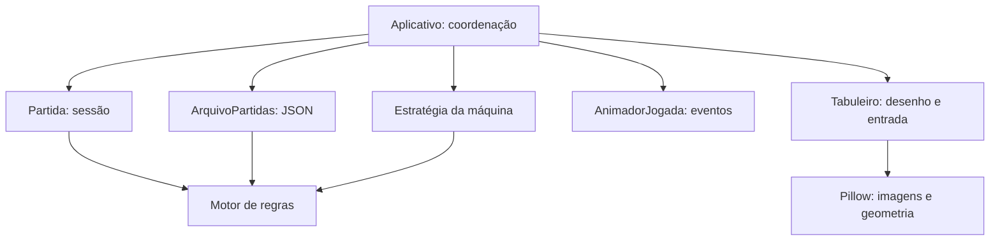

# Arquitetura e fluxo do jogo

Este guia descreve a implementação existente. O [README](../README.md) reúne instalação, comandos e regras para jogar; o [guia de contribuição](contribuicao.md) explica como documentar e alterar o código.

## Por onde começar a leitura

1. `mancala/regras.py`: leia `EstadoPartida`, `proxima_posicao` e `resolver_jogada`.
2. `mancala/partidas.py`: veja como `Partida.jogar` adota o resultado e como `ArquivoPartidas` o grava.
3. `mancala/interface.py`: acompanhe `selecionar_casa`, `executar_jogada` e `atualizar`.
4. `mancala/animacao.py` e `mancala/tabuleiro.py`: veja como os eventos se tornam imagens.
5. `mancala/estrategia.py`: acompanhe a escolha da máquina usando o mesmo motor.

## Responsabilidades e dependências

| Parte | Responsabilidade | Limite que deve ser preservado |
|---|---|---|
| `regras.py` | Estado, percurso, distribuição, captura e fim | Não conhece Tk, arquivos ou dificuldade |
| `Partida` em `partidas.py` | Configuração, identidade, estado atual e contagem de escolhas | Delega as regras ao motor; não salva sozinha |
| `ArquivoPartidas` em `partidas.py` | Persistência e validação dos JSONs | Não escolhe jogadas nem atualiza widgets |
| `estrategia.py` | Avaliação e busca de uma casa | Recebe um estado e devolve dados, sem acessar Tk |
| `Aplicativo` em `interface.py` | Telas, entrada, salvamento, animação e busca assíncrona | Coordena; não duplica as regras |
| `AnimadorJogada` em `animacao.py` | Reprodução temporal dos eventos | Não modifica a sessão ou o resultado |
| `Tabuleiro` em `tabuleiro.py` | Canvas, sementes, foco e seleção | Recebe casas permitidas; devolve a seleção por callback |
| `graficos.py` | Geometria e imagens Pillow reutilizáveis | Sem Tk ou gravação de PNGs |
| `aparencia.py` | Cores, fontes e controles compartilhados | Sem estado de partida |
| `tutorial.py` | Cenários e instruções dos exercícios | Usa o motor normal; não cria regras alternativas |
| `inicializacao.py`, `caminhos.py`, `diagnostico.py` | Entrada, localização de dados e verificações | Não participam da decisão de uma jogada |



As setas mostram as dependências principais de comportamento, não cada import. Por exemplo, o Canvas também lê constantes de posições do motor.

A separação é por responsabilidade, sem exigir uma classe para cada casa, semente ou lado. `Aplicativo` ainda reúne montagem das telas e coordenação: não é uma implementação estrita de MVC. Uma eventual separação dessa classe deve ser uma mudança própria, com testes, e não parte de uma edição de comentários.

## Estado e numeração

`EstadoPartida` é uma dataclass imutável com `sementes`, `jogador_atual` e `encerrada`. A tupla de sementes tem 14 inteiros indexados de 0 a 13; cada um admite de 0 a 48. A partida começa com **48 sementes**, quatro em cada uma das 12 casas. Os jogadores internos são 0 (A, embaixo) e 1 (B, em cima).

| Jogador | Casas na ordem de distribuição | Depósito |
|---|---|---|
| 0 / A | P0, P1, P2, P3, P4, P5 | P7 |
| 1 / B | P6, P8, P9, P10, P11, P12 | P13 |

```text
Percurso completo:
P0 → P1 → P2 → P3 → P4 → P5 → P7 → P6 → P8 → P9 → P10 → P11 → P12 → P13 → P0

Exemplos de proxima_posicao(posicao, jogador):
(5, 0)  → 7    entra no depósito próprio
(5, 1)  → 6    pula o depósito adversário P7
(12, 0) → 0    pula o depósito adversário P13
(12, 1) → 13   entra no depósito próprio
```

`PERCURSO` define a ordem e `PROXIMAS` permite consultar o próximo destino. Não substitua isso por `(posicao + 1) % 14`: P7 vem antes de P6. `proxima_posicao` apenas decide o destino; quem transfere a semente é `resolver_jogada`. A interface não exibe esses identificadores internos.

`OPOSTAS` associa as casas frente a frente: 0↔12, 1↔11, 2↔10, 3↔9, 4↔8 e 5↔6.

Entre jogadas, a soma é 48, os depósitos nunca diminuem e uma partida aberta precisa ter sementes nos dois lados. No fim, todas as casas estão vazias e as sementes estão nos depósitos. `validar_estado` confere esses invariantes, mas não prova que uma posição foi alcançada por uma sequência de jogadas legais. A construção direta de `EstadoPartida` não chama essa validação; `Partida` valida seu estado inicial e o carregamento valida os dados externos.

## Da abertura à primeira escolha

```text
main.py                       iniciar.pyw / comando instalado / EXE
  → inicializacao.main()        → inicializacao.iniciar()
                                    → inicializacao.main()
  → interpretar argumentos
      ├─ --verificar-instalacao → diagnóstico com dados temporários
      ├─ --medir-abertura       → medição com dados temporários
      └─ execução normal       → Tk → Aplicativo → menu → mainloop

Jogar → escolher modo
  ├─ dupla   → Partida → iniciar
  └─ máquina → escolher dificuldade → Partida → iniciar
```

`iniciar()` registra falhas de inicialização para a entrada sem console. `main.py` chama `main()` diretamente, permitindo ver a exceção no terminal. O loop de eventos do Tk processa cliques e chama `Aplicativo.atualizar`, agendado a cada 40 ms; esse intervalo é uma solicitação ao Tk, não uma garantia de frequência exata.

## Uma jogada completa

```text
Clique ou tecla
  → Tabuleiro / escolher_coluna
  → Aplicativo.selecionar_casa: entrada liberada? casa permitida no tutorial?
  → Aplicativo.executar_jogada
      → Partida.jogar
          → resolver_jogada
              1. validar a escolha
              2. retirar todas as sementes da casa
              3. repetir proxima_posicao e distribuir uma semente
              4. aplicar captura, se houver
              5. recolher sobras se um lado esvaziou
              6. determinar encerramento, turno extra ou troca de jogador
          ← ResultadoJogada com estado definitivo e eventos
          → adotar estado e incrementar jogadas
      → iniciar reprodução dos eventos
      → salvar resultado definitivo, exceto no tutorial
  → atualizar: exibir eventos até terminar a animação
  → liberar a próxima escolha, iniciar a máquina ou mostrar o fim
```

Uma escolha inválida gera `ValueError` antes de alterar a sessão. `Partida.jogar` não salva; a interface solicita o salvamento. Uma falha de disco é exibida ao jogador e não desfaz a jogada já aplicada.

### Resultado definitivo e reprodução visual

`ResultadoJogada` reúne o novo `estado`, os `eventos`, a quantidade `capturadas` e o indicador `turno_extra`. Os eventos são fotografias com tipo `retirada`, `distribuicao`, `captura` ou `recolha`.

- `partida.estado` guarda o resultado completo, mesmo enquanto a animação está começando.
- `tabuleiro_exibido` guarda o quadro visual atual. Nesse quadro, `sum(sementes) + na_mao == 48`.
- `AnimadorJogada.avancar(segundos)` retorna no máximo um evento por chamada ou `None` enquanto aguarda.

Os eventos não são um histórico persistente nem substituem o estado entre jogadas. Sair durante a distribuição preserva a jogada completa já salva; ao carregar, a animação não é repetida. A opção Sem animação consome os mesmos eventos. Mudar a velocidade altera somente a reprodução.

## Escolha da máquina sem bloquear a janela

1. Depois da animação, `atualizar` identifica o turno da máquina e chama `iniciar_calculo`.
2. A interface registra um prazo mínimo de cinco segundos usando `time.monotonic()` e captura o estado imutável atual.
3. Uma thread chama `escolher_jogada`. Ela não toca em widgets: envia `(geracao, resposta, erro)` por `queue.Queue`.
4. O Tk continua atendendo eventos. `receber_jogada_maquina` consulta a fila depois do prazo mínimo.
5. Uma resposta da geração atual passa para `executar_jogada`, o mesmo caminho usado para uma escolha humana.

Busca e espera acontecem juntas. Uma busca de quatro segundos ainda aguarda até completar os cinco; uma busca mais demorada é aplicada quando terminar, sem somar outra espera de cinco segundos. Turnos extras também passam por esse processo.

Ao trocar de tela, `interromper_calculo` sinaliza um `threading.Event` e incrementa `geracao`. O sinal pede que a busca pare; a geração descarta respostas antigas, inclusive as que já estavam na fila. Cancelar não significa matar a thread imediatamente. Em erro de busca, a interface avisa e passa a sessão para controle humano.

### Como a busca decide

Fácil sorteia uma opção válida. Normal e Difícil fazem aprofundamento progressivo com minimax e poda alfa-beta. Os limites atuais estão descritos no [README](../README.md#computador).

`avaliar_posicao` mantém a perspectiva do jogador que iniciou a busca. A cada nó, o jogador presente no estado define maximização ou minimização: turnos extras impedem simplesmente alternar por nível. A profundidade conta escolhas.

O cache existe apenas durante uma chamada de busca e inclui a profundidade restante na chave. Um valor pode ser exato, limite inferior ou limite superior; cortes alfa-beta não autorizam tratar todos os valores como exatos. A recomendação só é substituída após concluir uma profundidade inteira. Sem tempo para concluir nenhuma, permanece uma opção válida inicial.

`registrar_eventos=False` evita construir quadros visuais na busca; as regras e o resultado são os mesmos. Não há livro de aberturas nem garantia de jogo perfeito.

## Salvamento e compatibilidade

Cada sessão usa um JSON com nome derivado de seu identificador. O formato salvo atualmente é:

```json
{
  "modo": "dupla",
  "dificuldade": "Normal",
  "estado": {
    "sementes": [4, 4, 4, 4, 4, 4, 4, 0, 4, 4, 4, 4, 4, 0],
    "jogador_atual": 0,
    "encerrada": false
  },
  "identificador": "0123456789abcdef0123456789abcdef",
  "jogadas": 0,
  "versao": 1,
  "atualizado_em": "2026-11-10T12:00:00+00:00"
}
```

Esse é um exemplo de formato, não uma partida criada pelo guia. `modo` admite `dupla` ou `maquina`. A dificuldade admite `Fácil`, `Normal` ou `Difícil`; o identificador contém 32 caracteres hexadecimais minúsculos. `jogadas` conta escolhas concluídas. `versao: 1` é a versão do formato de dados, independente da versão do aplicativo.

O gravador escreve um `.tmp` no mesmo diretório e usa `os.replace` para substituir o JSON após a escrita completa. Isso evita expor um destino parcialmente escrito, mas não implementa coordenação entre duas instâncias salvando a mesma sessão. O carregamento valida os campos usados e o estado. A listagem preserva arquivos inválidos, retorna seus erros e ordena os válidos pelo horário de modificação do arquivo; ela não ordena por `atualizado_em`.

No código-fonte, os dados ficam em `partidas_salvas/` na raiz. No EXE, ficam em `%LOCALAPPDATA%\MancalaSoJoga\partidas_salvas`. Veja os caminhos completos e a migração no [README](../README.md#menus-e-partidas).

## Decisões que merecem cuidado

- **Tupla imutável para o estado:** a busca pode explorar alternativas e a interface pode guardar quadros sem modificar a posição original.
- **Um motor para jogo, tutorial e máquina:** evita regras divergentes entre modos.
- **Salvar antes de reproduzir:** mantém uma fronteira clara entre a jogada concluída e seus efeitos visuais.
- **Pillow sob demanda:** substitui os PNGs distribuídos por imagens determinísticas em memória. O custo de gerar gráficos na primeira abertura permanece; a [medição histórica](comparacao-local.md) registrou abertura mais lenta, apesar do EXE menor.
- **Cache limitado e referências Tk locais:** controlam o reaproveitamento durante redimensionamento. Imagens Pillow retornadas pelo cache devem ser tratadas como somente leitura; faça uma cópia antes de modificá-las. A propriedade não é imposta pelo objeto Pillow.

Detalhes de escala, geometria, suavização e limites do cache ficam no [guia da interface](interface.md), junto da descrição do desenho.
